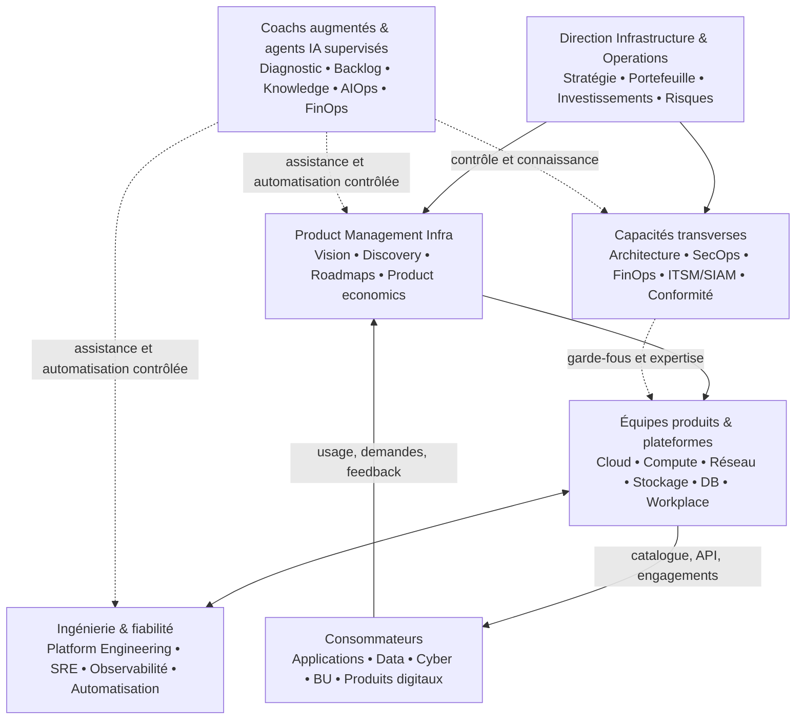

# Benchmark des modèles d'organisation des entités Infrastructure IT

**Édition : 3 novembre 2026**  
**Périmètre :** directions Infrastructure & Operations (I&O), départements infrastructure, équipes systèmes, réseau, datacenter, stockage, middleware, bases de données, cloud, plateformes internes, opérations et services techniques.  
**Finalité :** éclairer le diagnostic des organisations existantes, le choix d'un modèle cible et le positionnement de l'offre **Infra as a Product (IaaP)**, combinant transformation produit, coachs augmentés et agents IA.

> **Statut du document.** Ce benchmark est une synthèse de modèles de référence et une analyse d'expert. Il **ne constitue pas une étude statistique représentative** des organisations Infra : les notes comparatives, scénarios et cibles proposés sont des hypothèses de travail à valider lors de diagnostics clients. Les données d'enquête citées conservent le périmètre et les limites de leurs études d'origine.

## Sommaire

1. [Synthèse exécutive](#1-synthèse-exécutive)
2. [Objectifs, périmètre et méthode](#2-objectifs-périmètre-et-méthode)
3. [Tendances et données de marché](#3-tendances-et-données-de-marché)
4. [Taxonomie des modèles et grille de comparaison](#4-taxonomie-des-modèles-et-grille-de-comparaison)
5. [Fiches détaillées des dix modèles](#5-fiches-détaillées-des-dix-modèles)
6. [Matrice multicritère et lecture stratégique](#6-matrice-multicritère-et-lecture-stratégique)
7. [Choisir un modèle selon les réalités de l'entité](#7-choisir-un-modèle-selon-les-réalités-de-lentité)
8. [Target Operating Model Infra as a Product](#8-target-operating-model-infra-as-a-product)
9. [Gouvernance, responsabilités et interactions](#9-gouvernance-responsabilités-et-interactions)
10. [Diagnostic de maturité organisationnelle](#10-diagnostic-de-maturité-organisationnelle)
11. [Trajectoires de transformation](#11-trajectoires-de-transformation)
12. [Coachs augmentés et dispositif d'agents IA](#12-coachs-augmentés-et-dispositif-dagents-ia)
13. [Mesure de la performance et de la valeur](#13-mesure-de-la-performance-et-de-la-valeur)
14. [Risques, anti-patterns et arbitrages](#14-risques-anti-patterns-et-arbitrages)
15. [Conséquences pour l'offre et ses livrables](#15-conséquences-pour-loffre-et-ses-livrables)
16. [Références et sources](#16-références-et-sources)
17. [Annexes opérationnelles](#17-annexes-opérationnelles)

---

## 1. Synthèse exécutive

### 1.1. Les messages clés

Les organisations d'infrastructure n'évoluent pas toutes selon une trajectoire identique. Une grande direction I&O est souvent **composite** : des silos technologiques pour certains actifs critiques, une organisation ITSM pour les services mutualisés, un dispositif SIAM pour les fournisseurs, des équipes plateforme pour le cloud et un fonctionnement SRE sur certaines capacités numériques.

Six enseignements structurent ce benchmark :

1. **L'organigramme ne suffit pas.** La transformation concerne les responsabilités de bout en bout, le financement, la prise de décision, les interfaces entre équipes, le modèle d'exploitation et les métriques.
2. **Le modèle orienté produit n'implique pas une généralisation des squads.** Une équipe réseau, stockage ou mainframe peut porter un produit d'infrastructure tout en conservant une spécialisation forte, des gardes opérationnelles et des obligations de continuité.
3. **La séparation Build/Run est un choix de répartition des responsabilités, pas une fatalité.** On peut la conserver pour certains environnements réglementés, tout en améliorant les boucles de feedback et l'ownership du cycle de vie.
4. **Le Platform Engineering apporte une capacité de consommation autonome**, mais suppose une vraie démarche produit : recherche utilisateurs, priorisation, interfaces, adoption, mesure et maintenance du produit interne.
5. **Le modèle fédéré est une cible intéressante pour les grandes organisations**, car il équilibre standards communs, fiabilité, contrôle des risques et autonomie des équipes consommatrices ; il n'est toutefois ni universel ni nécessairement optimal pour une petite structure.
6. **L'IA doit améliorer le système de travail, pas masquer ses dysfonctionnements.** L'automatisation de processus fragmentés sans propriété claire peut accélérer les erreurs et complexifier le Run.

### 1.2. Recommandation pour Infra as a Product

La proposition de valeur peut se formuler ainsi :

> **Transformer chaque entité Infrastructure en fournisseur de produits et de capacités techniques fiables, lisibles et consommables, grâce à un modèle d'organisation adapté, à des pratiques de Product Management et à une augmentation maîtrisée des équipes par l'IA.**

Le principe central de l'offre est un **Target Operating Model (TOM) modulaire** comportant :

- un **portefeuille de produits et de services Infra** avec des propriétaires et des clients identifiés ;
- des **équipes produits d'infrastructure**, dimensionnées selon les capacités et le risque ;
- une **plateforme de consommation**, lorsque le self-service apporte de la valeur ;
- des capacités transverses de **SRE, ITSM, sécurité, architecture, FinOps et SIAM** ;
- une **gouvernance fédérée** pour les standards et les arbitrages ;
- un dispositif de **coachs augmentés et d'agents IA** pour accélérer le diagnostic, le design, l'adoption et l'exploitation.

### 1.3. Ce qu'il faut éviter

- Opposer « ITIL » et « Produit » : les disciplines de service management, de fiabilité et de product management sont complémentaires.
- Requalifier toutes les équipes en « squads » sans changer leurs responsabilités ni leurs modes d'interaction.
- Définir la plateforme comme la somme des outils existants, sans expérience consommateur ni interface stable.
- Appliquer les métriques DORA logicielles telles quelles au réseau physique, au mainframe ou à tous les processus infrastructure.
- Viser l'agent IA autonome sur des opérations de production sensibles avant d'avoir sécurisé identités, autorisations, validation, journalisation et capacité de retour arrière.

---

## 2. Objectifs, périmètre et méthode

### 2.1. Questions auxquelles répond le benchmark

- Quels sont les principaux modèles d'organisation Infrastructure IT et leurs variantes ?
- À quels contextes chaque modèle répond-il le mieux ?
- Quelles tensions créent-ils entre expertise, coût, vitesse, expérience client, fiabilité et gouvernance ?
- Quels modèles sont les plus compatibles avec l'approche Infra as a Product ?
- Comment passer du modèle actuel à un modèle cible sans mettre en risque la production ?
- Comment y intégrer concrètement des coachs augmentés et des agents IA ?

### 2.2. Trois niveaux d'analyse à distinguer

| Niveau | Question | Exemples |
|---|---|---|
| **Structure organisationnelle** | Qui est regroupé avec qui ? | Silos technologiques, centre partagé, équipe de BU, fédération hub-and-spoke |
| **Operating model** | Qui décide, finance, développe, opère et rend compte ? | Build/Run, Service Ownership, Product Ownership, SIAM, responsabilités partagées |
| **Pratiques / capacités** | Comment travaille-t-on et avec quels moyens ? | ITSM, SRE, DevOps, Platform Engineering, FinOps, IaC, AIOps, agents IA |

**Conséquence :** certains des « dix modèles » comparés sont **combinables** et ne correspondent pas à dix organigrammes exclusifs. Le CCoE, par exemple, est une fonction d'animation transverse et ne constitue pas à lui seul un Cloud Operating Model, distinction explicitée par AWS [S8].

### 2.3. Critères d'évaluation

Les modèles sont analysés au regard de :

1. **Contrôle et standardisation** : architecture, procédures, sécurité, conformité.
2. **Autonomie des consommateurs** : possibilité d'obtenir ou d'exploiter une capacité avec peu de dépendances.
3. **Orientation client / produit** : besoins, adoption, roadmap, valeur et expérience.
4. **Fiabilité et maîtrise opérationnelle** : continuité, incidents, changements, observabilité.
5. **Efficience économique** : mutualisation, transparence des coûts, gestion de la demande.
6. **Adaptation au legacy et au physique** : mainframe, datacenter, réseau, dépendances matérielles.
7. **Capacité de transformation** : autonomie de décision, cadence d'amélioration, disponibilité des compétences.
8. **Prédisposition à l'automatisation et à l'IA** : données fiables, interfaces, processus standardisés, garde-fous.

### 2.4. Corpus documentaire

Les sources sont principalement des **référentiels de pratiques** et des **enquêtes sectorielles** : Team Topologies [S1], Microsoft Cloud Adoption Framework [S2], Google SRE [S3], CNCF [S4]–[S5], DORA [S6], Scopism/SIAM [S7], AWS [S8], FinOps Foundation [S9] et NIST [S10]. Les sources sont référencées et datées en section 16.

**Limite :** aucune des enquêtes mentionnées ne permet, seule, de quantifier la part des **directions Infrastructure IT françaises** qui adopte chacun des dix modèles. Les chiffres de marché ne sont donc ni des parts de marché ni des proportions d'organigrammes d'infrastructure.

---

## 3. Tendances et données de marché

### 3.1. Tendances structurantes

| Tendance | Déclencheur typique | Effet organisationnel | Implication pour IaaP |
|---|---|---|---|
| **Hybridation et multicloud** | Coexistence de legacy, datacenter, clouds publics | Besoin d'intégration et de règles communes | Concevoir des produits transversaux, pas seulement une « usine Cloud » |
| **Demande de self-service** | Attente de délais courts des équipes applications/data | Déplacement du travail de ticket vers API/portail | Piloter l'expérience consommateur et les parcours |
| **Fiabilité sous contraintes** | Systèmes critiques, RTO/RPO, exigences de continuité | Renforcement de l'ownership et de l'observabilité | Intégrer SRE et ITSM au modèle produit |
| **Concentration sur le coût et la valeur** | Inflation de la complexité et des consommations | Développement de FinOps/ITAM et coût unitaire | Inscrire l'économie dans la roadmap des produits |
| **Écosystème multi-fournisseurs** | Outsourcing, SaaS, infogérance | Intégration de service et responsabilités partagées | Utiliser SIAM pour restaurer la responsabilité de bout en bout |
| **IA et automatisation** | Productivité, diagnostic, documentation, incidents | Copilotes et automations supervisées | Positionner les coachs augmentés comme mécanisme d'adoption |

### 3.2. Indicateurs observés dans des enquêtes

| Étude | Résultat rapporté | Lecture utile | Limite de lecture |
|---|---|---|---|
| **DORA 2025** [S6] | **90 %** des organisations répondantes déclarent utiliser une plateforme interne ; **76 %** disposent d'équipes plateforme dédiées | La question se déplace de l'installation d'une plateforme vers sa qualité et sa gouvernance | Échantillon orienté développement logiciel ; ne mesure pas toutes les entités Infra |
| **CNCF / SlashData, mars 2026** [S5] | **41 %** déclarent une gestion des capacités de plateforme par collaboration multi-équipes ; **28 %** une équipe Platform Engineering dédiée | La gestion fédérée ou collaborative des plateformes est structurante | Définitions et population différentes de DORA : chiffres non comparables directement |
| **State of FinOps 2026** [S9] | **60 %** de structures centralisées d'enablement ; **21 %** hub-and-spoke, soit **81 %** cumulés | Un noyau de compétences peut fédérer des propriétaires locaux sans centraliser toute l'exécution | Mesure les équipes FinOps, pas l'organigramme Infrastructure dans son ensemble |

**Lecture stratégique :** ces chiffres soutiennent l'intérêt des plateformes, de la responsabilité distribuée et des dispositifs d'enablement. Ils **ne prouvent pas** que tout département Infra doit adopter le même modèle.

### 3.3. Points de doctrine utiles

- **Microsoft** décrit les modèles Cloud **centralisé**, **décentralisé** et **à gestion partagée**, ainsi que leurs combinaisons hybrides. Dans le modèle partagé, les équipes plateformes fournissent des produits et garde-fous communs tandis que les équipes de workloads opèrent avec autonomie [S2].
- **Team Topologies** distingue quatre types d'équipes (stream-aligned, platform, enabling, complicated subsystem) et trois modes d'interaction (collaboration, X-as-a-Service, facilitation) [S1].
- **Google SRE** propose plusieurs modalités d'engagement — notamment consulting, collaboration et présence embarquée — selon la criticité et le besoin d'ingénierie [S3].
- **CNCF** évalue la maturité Platform Engineering selon cinq axes : Investment, Adoption, Interfaces, Operations, Measurement, chacun en quatre niveaux [S4].
- **DORA 2025** présente l'IA comme un **amplificateur** des forces et faiblesses organisationnelles : les fondamentaux de la plateforme et de la collaboration restent déterminants [S6].

---

## 4. Taxonomie des modèles et grille de comparaison

### 4.1. Les dix archétypes retenus

| ID | Modèle | Structure / logique dominante | Question principale traitée |
|---|---|---|---|
| M1 | **Silos technologiques** | Équipes par spécialité | Comment garantir l'expertise sur les composants ? |
| M2 | **Build / Run séparés** | Responsabilités par phase du cycle de vie | Comment protéger le Run et absorber les projets ? |
| M3 | **Centre de services mutualisés** | Capacités partagées et catalogue | Comment industrialiser la prestation ? |
| M4 | **Organisation orientée services** | Service Ownership de bout en bout | Qui garantit la qualité du service vécu ? |
| M5 | **Décentralisation par BU ou domaine** | Équipes au plus près des besoins locaux | Comment maximiser la réactivité ? |
| M6 | **Externalisation / SIAM** | Écosystème de prestataires coordonnés | Comment piloter plusieurs fournisseurs comme un système ? |
| M7 | **Cloud / CCoE** | Expertise Cloud centrale et gouvernance transverse | Comment accélérer l'adoption Cloud sans dérive ? |
| M8 | **DevOps / SRE** | Responsabilité partagée et ingénierie de fiabilité | Comment concilier vitesse et résilience ? |
| M9 | **Platform Engineering / Infra as a Product** | Plateformes internes traitées comme des produits | Comment rendre des capacités consommables en autonomie ? |
| M10 | **Fédéré / hybride** | Noyau commun + ownership distribué | Comment équilibrer contrôle, standardisation et autonomie ? |

### 4.2. Modèles souvent combinés dans la pratique

| Combinaison | Pourquoi elle fonctionne | Point de vigilance |
|---|---|---|
| M1 + M4 | Préserve l'expertise tout en instituant un responsable de service | Responsabilités doubles à clarifier |
| M3 + M9 | Industrialise le catalogue vers API, portail et self-service | Ne pas rebaptiser un portail de tickets « plateforme » |
| M6 + M4 | Permet une promesse de service de bout en bout malgré plusieurs fournisseurs | Autorité réelle de l'intégrateur et visibilité contractuelle |
| M7 + M9 | Transforme le CCoE d'un centre de standards vers une offre de produits plateformes | Éviter un nouveau guichet central bloquant |
| M8 + M9 | Relie expérience développeur, SLO et engineering | Clarifier les astreintes et le traitement des incidents transverses |
| M10 + M4 + M9 | Associe ownership service, produit et gouvernance fédérée | Complexité de l'arbitrage et coût des interfaces |

---

## 5. Fiches détaillées des dix modèles

> **Cadre de lecture :** chaque fiche précise le principe, une organisation type, les cas favorables, les avantages, les limites, les symptômes d'essoufflement et les leviers de transformation IaaP.

### M1 — Organisation en silos technologiques

**Principe.** Les équipes sont regroupées par expertise ou par technologie : Réseau, Systèmes, Stockage, Sauvegarde, Bases de données, Mainframe, Virtualisation, Middleware, etc. Les demandes traversent plusieurs équipes selon le composant concerné.

**Organisation type :** Direction Infra → responsables de domaines techniques → équipes spécialistes, avec un Service Desk et une coordination transverse pour les demandes et incidents.

**Contextes pertinents :** infrastructures très spécialisées, parcs historiques, équipements physiques, fortes exigences de support constructeur, organisation de taille suffisamment grande pour entretenir les expertises.

**Forces :**

- concentration du savoir-faire et maintien des expertises rares ;
- standards techniques homogènes à l'intérieur de chaque domaine ;
- lisibilité des responsabilités d'ingénierie sur les actifs ;
- mutualisation des spécialistes et facilité d'escalade technique.

**Limites :**

- multiples transferts pour livrer un service complet ;
- optimisation locale des composants au détriment de l'expérience consommateur ;
- délais de traitement liés aux files d'attente et priorités contradictoires ;
- difficulté à comprendre le coût, la disponibilité et la valeur d'un produit complet.

**Signaux d'alerte :** délais importants pour un changement simple ; incidents transférés entre trois équipes ou plus ; impossibilité de nommer un responsable de bout en bout ; demandes d'intégration systématiques.

**Levier IaaP :** garder le socle d'expertise, mais construire **une couche explicite de produits/services** : consommateur, proposition de valeur, owner, parcours de commande, SLO, coûts, roadmap et backlog commun. Exemple : l'équipe stockage devient contributrice majeure d'un produit « Storage as a Service », sans dissoudre la spécialité stockage.

**Premiers cas d'usage IA :** classification de tickets, synthèse de dépendances, assistant de documentation et d'analyse d'incidents ; pas de déploiement autonome non contrôlé.

### M2 — Séparation Build / Run

**Principe.** Des équipes conçoivent et livrent les changements (Build), d'autres assurent l'exploitation quotidienne et la continuité (Run). Un processus de transfert encadre les mises en production et l'acceptation en exploitation.

**Organisation type :** pôle Projets/Engineering, pôle Exploitation/Operations, gouvernance des changements et de l'entrée en service.

**Contextes pertinents :** enjeux importants de continuité, obligations contractuelles, fortes contraintes de validation, services à faible rythme de changement et infrastructures critiques.

**Forces :**

- protection de la capacité opérationnelle et des astreintes ;
- spécialisation des procédures d'exploitation ;
- gestion structurée de la mise en service et des preuves de conformité ;
- allocation de coûts Build / Run relativement explicite.

**Limites :**

- transfert parfois tardif de la connaissance vers le Run ;
- dette d'exploitabilité et faible automatisation des gestes répétitifs ;
- incitations divergentes : accélérer le delivery contre minimiser le changement ;
- délai plus long entre retour d'incident et correction durable.

**Signaux d'alerte :** retours de mise en production ; runbooks incomplets ; backlog de problèmes chroniques ; incidents causés par changements mal préparés.

**Levier IaaP :** introduire un **ownership produit sur l'ensemble du cycle de vie**, des objectifs communs Build/Run, des critères de production readiness et, quand c'est pertinent, des équipes intégrées ou des engagements SRE. La séparation hiérarchique peut subsister sans empêcher une responsabilité produit partagée.

**Premiers cas d'usage IA :** génération assistée de runbooks validés, contrôle documentaire de readiness, rapprochement incidents/changements, analyse des causes probables.

### M3 — Centre de services mutualisés / Shared Services

**Principe.** Une structure centrale fournit des services standardisés via catalogue, SLA/OLA, demandes et processus ITSM, au bénéfice de plusieurs équipes ou entités clientes.

**Organisation type :** responsable centre de services, gestionnaires de services, équipes de réalisation/exploitation, Service Desk, catalogue et reporting.

**Contextes pertinents :** multi-entités, besoins répétables, économies d'échelle recherchées, services stables ou fortement mutualisés.

**Forces :** standardisation, couverture et support homogènes, rationalisation des actifs, lisibilité contractuelle, massification des achats et de l'exploitation.

**Limites :** logique fournisseur/consommateur parfois réduite à un contrat de SLA ; dépendance au traitement de tickets ; faible capacité d'innovation ; investissement souvent piloté par budgets historiques plutôt que valeur d'usage.

**Signaux d'alerte :** catalogue riche mais peu utilisé ; commandes complexes ; délais d'approvisionnement imprévisibles ; difficultés à expliquer le coût unitaire et la valeur des services.

**Levier IaaP :** distinguer **catalogue de services** et **portefeuille de produits**. Faire évoluer les offres à forte demande vers des produits à cycle de vie piloté : personas, parcours de consommation, roadmap, gestion de capacité, feedback, adoption et self-service lorsque rentable.

**Premiers cas d'usage IA :** assistant de catalogue, qualification de demandes, identification des causes de réouverture, recommandation de standard, synthèse des irritants clients.

### M4 — Organisation orientée services / Service Ownership

**Principe.** Les services sont gérés de bout en bout, indépendamment de leurs composants. Un Service Owner porte les engagements de qualité, la coordination des contributeurs et la vision de la performance délivrée.

**Organisation type :** portefeuille de services, Service Owners, équipes techniques contributrices, gouvernance de service, processus ITSM et comités consommateurs.

**Contextes pertinents :** organisations déjà structurées par SLA, services transversaux dépendant de nombreuses équipes, transition depuis des silos ou un centre de services.

**Forces :** responsabilité client visible, pilotage de la qualité, coordination transverse, meilleure relation avec les métiers et les équipes applications.

**Limites :** Service Owners parfois sans pouvoir sur le budget et les priorités techniques ; superposition complexe avec l'organigramme ; gestion réactive centrée sur le SLA plutôt que sur l'adoption et l'évolution du service.

**Signaux d'alerte :** qualité de service correcte mais faible satisfaction ; roadmaps absentes ; changement de demande traité exclusivement en projet ; conflits fréquents entre Service Owner et responsables de domaines.

**Levier IaaP :** enrichir le rôle de service par des pratiques **Product Management** : segmentation des consommateurs, proposition de valeur, vision, priorisation, arbitrage valeur/coût/risque, lifecycle et métriques d'usage. Service Owner et Product Manager peuvent être deux personnes distinctes, des rôles cumulés, ou des responsabilités partagées selon la taille et la criticité.

**Premiers cas d'usage IA :** synthèse des voix clients, consolidation des incidents/SLA/SLO, préparation de revues de service et priorisation fondée sur les faits.

### M5 — Infrastructure décentralisée par BU ou domaine

**Principe.** Des capacités infrastructure sont intégrées directement aux business units, domaines digitaux ou trains de produit applicatifs, avec une autonomie importante dans les décisions et l'exploitation.

**Organisation type :** équipes Infra locales rattachées aux BU ; parfois une architecture, une sécurité et une achats IT centrales.

**Contextes pertinents :** besoins locaux spécifiques, forte pression d'innovation, entités autonomes, domaines ayant les compétences et les moyens de gérer les risques.

**Forces :** proximité de la demande, priorisation plus simple, réactivité, appropriation des résultats par les équipes clientes.

**Limites :** duplication des compétences, outillage et contrats ; standards divergents ; difficulté de support 24/7 ; fragilité des compétences rares ; hétérogénéité de sécurité et de maîtrise financière.

**Signaux d'alerte :** plusieurs solutions répondant au même besoin ; surcoûts de licences ; écarts de politiques ; dépendance à un seul expert local ; absence de vue groupe des risques.

**Levier IaaP :** conserver l'ownership local pour les capacités différenciantes et fédérer les **fondations non différenciantes** (identité, connectivité, landing zones, observabilité de base, sécurité, contrats). Mettre en place une plateforme consommable et des standards testables.

**Premiers cas d'usage IA :** contrôles de conformité, accompagnement aux standards, comparaison des choix d'architecture, analyse de duplications de capacités.

### M6 — Infrastructure externalisée / SIAM multi-fournisseurs

**Principe.** L'infrastructure est partiellement ou largement délivrée par des prestataires externes. Une capacité d'**intégration des services** organise la coopération des fournisseurs et garantit les services de bout en bout. Le SIAM est une méthodologie de coordination, pas automatiquement un organigramme unique [S7].

**Organisation type :** fonction de gouvernance conservée chez le client, intégrateur de services (interne, externe ou hybride), fournisseurs de composants/services, responsables de service et gestion contractuelle.

**Contextes pertinents :** externalisation historique, multisourcing, diversité des opérateurs cloud et datacenter, besoin de maîtrise contractuelle et opérationnelle.

**Forces :** capacité industrielle, accès à des compétences, mutualisation des activités de production, contrats et processus explicites, approche cohérente des interfaces fournisseurs lorsque le SIAM est mature.

**Limites :** dépendance à la qualité des données et contrats, lenteur des évolutions hors périmètre, opacité de certaines chaînes de sous-traitance, difficultés de co-innovation et de pilotage de la valeur.

**Signaux d'alerte :** incidents sans responsable global ; fournisseurs optimisant leurs SLA individuels ; changements contractuels pour des évolutions mineures ; CMDB et reporting incohérents entre acteurs.

**Levier IaaP :** réaffirmer un **Product Owner ou Service Owner côté client**, qui définit la promesse et la roadmap ; contractualiser les capacités, API, automatisations, SLO et données nécessaires. Faire converger les fournisseurs autour d'un parcours produit plutôt que de simples engagements en silos.

**Premiers cas d'usage IA :** corrélation multi-outils, consolidation de comptes rendus, contrôle des engagements et préparation de revues fournisseurs, en respectant confidentialité et restrictions contractuelles.

### M7 — Cloud Infrastructure / Cloud Center of Excellence (CCoE)

**Principe.** Une fonction Cloud transverse définit principes, architecture, standards, mécanismes d'adoption, sécurité et automatisation. Elle peut contribuer à un modèle Cloud centralisé ou partagé. **Un CCoE n'est pas à lui seul le Cloud Operating Model** [S8].

**Organisation type :** CCoE, Cloud Platform Team, Cloud Security, FinOps, équipes workloads et architecture d'entreprise.

**Contextes pertinents :** adoption Cloud en croissance, hybrides/multicloud, transformation des pratiques d'ingénierie et besoins de landing zones communes.

**Forces :** capitalisation, cohérence des plateformes, standardisation du provisionnement, diffusion des compétences, maîtrise des garde-fous.

**Limites :** risque d'architecture de validation centralisée, multiplication des comités, concentration excessive des opérations dans l'équipe centrale, adoption d'une technologie avant clarification des produits clients.

**Signaux d'alerte :** équipe Cloud saturée de tickets ; accès aux environnements lent ; landing zones personnalisées à l'excès ; guerres de responsabilités entre Cloud et infrastructures historiques.

**Levier IaaP :** faire évoluer le CCoE vers une **fonction d'enablement et de gouvernance**, et la Cloud Platform vers des **produits internes** avec contrats d'interface, SLO et roadmap. Adopter un partage explicite des responsabilités plateforme/workloads comme dans les modèles à gestion partagée [S2].

**Premiers cas d'usage IA :** analyse de conformité IaC, aide au provisioning, diagnostic de configuration, recommandations FinOps et assistance au catalogue Cloud.

### M8 — DevOps / Site Reliability Engineering (SRE)

**Principe.** Le DevOps réduit les frontières entre développement, ingénierie et opérations ; le SRE traite la fiabilité comme un problème d'ingénierie, avec objectifs de service, automatisation, observabilité et gestion du toil. Ce sont **des approches de fonctionnement** qui peuvent s'intégrer à plusieurs structures.

**Organisation type :** ownership Build/Run par équipes de produit, SRE embarqués, SRE transverses ou fonction SRE consultative ; gestion des SLO et des incidents.

**Contextes pertinents :** plateformes logicielles, infrastructure programmable, forte fréquence de changement, services critiques disposant de télémétrie et d'équipes d'ingénierie.

**Forces :** meilleure boucle d'apprentissage entre incidents et conception, réduction du travail manuel, fiabilité mesurée, arbitrage explicite vitesse/risque, amélioration continue.

**Limites :** coût de transformation des compétences, surcharge d'astreinte, risque de confusion entre « avoir un SRE » et « faire du SRE », couverture partielle des technologies moins automatisables.

**Signaux d'alerte :** astreintes non soutenables ; SLO inconnus ; incidents sans postmortem exploitable ; « équipe SRE » utilisée comme un nouveau Run central.

**Levier IaaP :** intégrer des **objectifs de fiabilité et d'exploitabilité** au product backlog, définir les SLO pertinents par produit, traiter le toil, mesurer la valeur utilisateur et conserver les responsabilités de production explicites. Google documente des engagements SRE variables selon le contexte [S3].

**Premiers cas d'usage IA :** assistance à l'investigation, recherche dans les événements/runbooks, création de postmortems préremplis, propositions de remédiations vérifiées par humain.

### M9 — Platform Engineering / Infrastructure as a Product

**Principe.** Des équipes conçoivent et exploitent des **plateformes internes comme des produits** pour les équipes applicatives, data, cyber ou autres consommateurs IT. L'objectif est de masquer la complexité non différenciante et de rendre les capacités découvrables, standardisées et consommables en autonomie [S4], [S6].

**Organisation type :** Platform Product Manager ou Product Owner, Platform Engineering, spécialistes infra, expérience développeur, opérations/SRE intégrées ou mutualisées, représentants des consommateurs.

**Contextes pertinents :** demandes répétées, infrastructures programmables, multiplicité d'équipes clientes, volonté de réduire les délais de livraison et la charge cognitive.

**Forces :** standardisation sans dépendance systématique aux tickets, chemins de consommation éprouvés (« golden paths »), adoption mesurable, économie d'échelle, interfaces claires, capacité d'automatisation.

**Limites :** coût initial de création et de maintenance ; risque de sur-construire une plateforme ; nécessité de solides compétences produit ; transformations complexes sur les composants physiques ; dette liée aux API/produits internes mal maintenus.

**Signaux d'alerte :** portail peu adopté ; équipe plateforme jugée comme « fournisseur d'outils » ; roadmap interne dominée par les demandes ponctuelles ; multiplication de services sans responsable de cycle de vie.

**Levier IaaP :** installer une **véritable discipline produit** : segmentation utilisateurs, discovery, portefeuille, product economics, expérience, mesure d'adoption, UX de consommation, versioning, dépréciation, fiabilité et boucle feedback. Éviter d'imposer le self-service là où le volume ou le risque ne le justifie pas.

**Premiers cas d'usage IA :** copilote de découverte et commande, suggestions IaC validées, génération de documentation, support contextualisé, analyse des parcours abandonnés.

### M10 — Modèle fédéré / hybride (hub-and-spoke)

**Principe.** Un noyau central définit standards, capacités mutualisées et exigences, tandis que des unités/équipes produits assument la consommation, la configuration ou l'exploitation locale dans un périmètre d'autonomie explicite. Les frontières diffèrent selon les services et les risques.

**Organisation type :** direction Infrastructure/Platform Portfolio, équipes de produits transverses, équipes locales/domaines, fonctions SRE/ITSM/SecOps/FinOps/SIAM, communauté de pratiques et gouvernance d'architecture.

**Contextes pertinents :** grands groupes, infrastructures multi-technologies, fédération de BU, coexistence on-premises/cloud, différents niveaux de maturité locale.

**Forces :** équilibre entre capacité d'industrialisation et proximité du besoin, mutualisation des fondations, autonomie sous garde-fous, extensibilité à l'hétérogénéité du parc.

**Limites :** rôle ambigu de la couche centrale ; conflit de priorités globales/locales ; coûts de coordination ; risque d'un modèle théorique trop complexe ; besoin de mécanismes d'arbitrage et de données communes.

**Signaux d'alerte :** chaque décision passe devant deux comités ; les équipes locales contournent la plateforme ; qualité différente d'une BU à l'autre ; conflits de facturation ou de responsabilité lors d'incidents.

**Levier IaaP :** définir **trois contrats explicites** : (1) produit consommable et niveaux de service ; (2) autonomie/guardrails de l'équipe consommatrice ; (3) responsabilités d'exploitation et de reprise. Évaluer régulièrement ce qui doit être centralisé, mutualisé ou laissé local.

**Premiers cas d'usage IA :** assistant de standards et décisions, agrégation de KPIs, comparaison de pratiques entre entités, contrôle des garde-fous, copilote de gouvernance.

---
## 6. Matrice multicritère et lecture stratégique

### 6.1. Matrice comparative qualitative

Les appréciations ci-dessous décrivent le **potentiel du modèle correctement mis en œuvre**, et non la performance constatée d'une organisation. Échelle : **F** = faible, **M** = moyenne, **É** = élevée, **TÉ** = très élevée. Les notes ne constituent **pas un classement absolu**.

| Modèle | Standards / contrôle | Autonomie consom. | Orientation produit | Maîtrise du Run | Compatibilité legacy | Potentiel de self-service |
|---|---|---|---|---|---|---|
| **M1 — Silos** | É | F | F | É (par composant) | TÉ | F |
| **M2 — Build/Run** | É | F | F | É | TÉ | F à M |
| **M3 — Services mutualisés** | TÉ | F à M | M | É | TÉ | M |
| **M4 — Orienté services** | É | M | M à É | É | É | M |
| **M5 — Décentralisé BU** | F à M | TÉ | Variable | Variable | M | M à É |
| **M6 — Externalisé / SIAM** | É (processus) | Variable | Variable | É si pilotage mature | TÉ | Variable |
| **M7 — Cloud / CCoE** | É | M | M | É | M | É |
| **M8 — DevOps / SRE** | M à É | É | M à É | TÉ si SRE mature | M | É |
| **M9 — Platform / Produit** | É | TÉ | TÉ | É | M à É | TÉ |
| **M10 — Fédéré / hybride** | É si gouverné | É | É à TÉ | É | TÉ | É |

**Interprétation importante :** la compatibilité legacy d'un modèle Platform Engineering dépend de la possibilité d'exposer **une interface produit utile**, pas nécessairement une API automatisant le matériel physique. Une offre de capacité réseau avec engagements clairs et provisionnement partiellement automatisé peut déjà relever d'une logique produit.

### 6.2. Matrice des arbitrages structurants

| Arbitrage | Option 1 | Option 2 | Question de décision |
|---|---|---|---|
| **Centralisation** | Un socle imposé | Autonomies locales | Quelles capacités peuvent être différentes sans dégrader sécurité, coût et interopérabilité ? |
| **Organisation** | Équipes composants | Équipes produits | Quelle frontière produit limite les handoffs sans faire perdre l'expertise rare ? |
| **Financement** | Budget fonctionnel annuel | Financement de produits/capacités | Quel niveau de continuité financière est nécessaire pour la roadmap et le Run ? |
| **Engagements** | SLA de fournisseurs | SLO orientés usage | Comment mesurer la qualité réellement ressentie par le consommateur ? |
| **Consommation** | Ticket et validation | API/portail/self-service | Le volume, le risque et la standardisation justifient-ils l'automatisation ? |
| **Exploitation** | Run mutualisé | You Build It, You Run It / SRE | Qui possède réellement les compétences et la capacité d'astreinte ? |
| **Décision** | Comités centralisés | Garde-fous codifiés | Quels risques doivent rester soumis à une validation explicite ? |
| **IA** | Assistance à la décision | Remédiation autonome | Le cas d'usage est-il réversible, observable et autorisé ? |

### 6.3. Cinq conclusions opérationnelles

1. **L'organisation historique n'est pas nécessairement à supprimer** : il est souvent moins risqué d'ajouter l'ownership produit et de simplifier les interactions que d'engager immédiatement une réorganisation hiérarchique.
2. **Le passage par l'orientation service** peut être particulièrement efficace pour les organisations ITIL ou multi-fournisseurs : il fournit les responsabilités et engagements sans attendre la plateforme cible.
3. **L'outillage ne définit pas le modèle** : un portail ITSM n'est pas automatiquement une plateforme produit ; Kubernetes ne garantit pas le Platform Engineering.
4. **La répartition du Run est un design à part entière** : la qualité du support, les astreintes, la capacité d'ingénierie, les niveaux de service et les droits d'action doivent être explicitement conçus.
5. **Le modèle fédéré n'est mature que si les contrats d'interface sont simples** : standards minimum, délégations, matrice de décisions et mécanismes d'escalade doivent être lisibles par les équipes.

---

## 7. Choisir un modèle selon les réalités de l'entité

### 7.1. Matrice de recommandation par profil

| Profil d'entité | Situation initiale typique | Modèle cible privilégié | Démarche initiale recommandée | Vigilance |
|---|---|---|---|---|
| **Infrastructure on-premises historique** | Silos + projets + Run | M1 + M4, puis produits ciblés M9 | Cartographier 3–5 services et nommer leurs owners | Éviter la réorganisation générale et la rupture d'astreinte |
| **Réseau / télécom interne** | Fortes dépendances physiques | M4 + M9 partiel | Définir offres connectivité, changements standard, qualité et délais | Provisionnement physique non toujours automatisable |
| **Mainframe et systèmes critiques** | Expertises rares, forte disponibilité | M1 + M4 + SRE sélectif | Lifecycle produit, documentation, exigences de résilience, modernisation incrémentale | Perte des savoirs et contraintes de maintenance |
| **Centre de services ITSM mature** | Catalogue + SLA, nombreux tickets | M3 + M4 → M9 | Sélectionner les demandes récurrentes à productiser | Ne pas confondre taux de tickets résolus et valeur perçue |
| **Cloud / conteneurs** | CCoE, outillage IaC, landing zones | M7 + M9 + M8 | Personas, golden paths, product discovery, SLO | Sur-ingénierie et surcharge plateforme |
| **Groupe multi-BU** | Variantes locales et duplications | M10 + M9 + M4 | Définir commun vs local, contrats de délégation | Arbitres et budgets multi-entités |
| **Multi-infogérants / multisourcing** | Contrats cloisonnés, reporting fragmenté | M6 + M4 + M9 ciblé | Identifier owner côté client et flux incident/changement transverses | Contraintes contractuelles et accès aux données |
| **Petite équipe Infra polyvalente** | Peu de spécialistes, nombreuses sollicitations | M4 + pratiques produit légères | Owner identifiable, backlog unique, catalogue court | Ne pas multiplier les rôles formels |
| **Organisation en fort changement réglementaire** | Gouvernance forte, faible cadence | M4 + M10 à autonomie limitée | Définir garde-fous et chemins standard pré-approuvés | Exigences de preuve et séparation des tâches |

### 7.2. Six questions de décision

1. Les demandes sont-elles **standardisables** ou majoritairement sur mesure ?
2. Les consommateurs ont-ils besoin d'une **autonomie d'exécution** ou surtout d'engagements fiables et de visibilité ?
3. L'entité dispose-t-elle d'un **volume suffisant** pour amortir une plateforme et des interfaces automatisées ?
4. Où résident les **compétences rares** et quelles seraient les conséquences de leur dispersion ?
5. Quelles parties du Run doivent être **centralisées** pour assurer la continuité, l'astreinte et la conformité ?
6. Quels droits de décision peut-on déléguer sous **garde-fous vérifiables** ?

### 7.3. Principes de segmentation du portefeuille

Les frontières produits doivent découler du **besoin de consommation** et non exclusivement de l'organigramme technique. Trois niveaux sont utiles :

- **Capacité d'infrastructure :** compute, stockage, réseau, identité, observabilité, backup, bases de données, conteneurs.
- **Produit consommable :** machine virtuelle standard, espace de stockage managé, segment réseau sécurisé, environnement Kubernetes, base managée, solution de sauvegarde, landing zone.
- **Parcours ou offre composite :** « environnement applicatif prêt à déployer », « landing zone data sécurisée », « reprise d'activité d'une application critique ».

Un **produit** doit avoir un ensemble cohérent de consommateurs, un résultat attendu, un propriétaire, une proposition de valeur, une interface de consommation, un cycle de vie et des engagements. Une **simple technologie** ou un **projet temporaire** ne suffit pas.

---

## 8. Target Operating Model Infra as a Product

### 8.1. Architecture organisationnelle de référence



Ce schéma décrit des **responsabilités logiques**, pas une exigence de création de départements supplémentaires. Dans une structure réduite, plusieurs rôles peuvent être portés par la même personne ou équipe. Dans une grande DSI, certains rôles seront distribués entre plusieurs entités.

### 8.2. Les sept piliers du TOM

| Pilier | Décisions structurantes | Artefacts attendus |
|---|---|---|
| **P1 — Portefeuille produits** | Que fournit l'Infra, à qui, avec quelle valeur ? | Product map, segmentation consommateurs, stratégie du portefeuille |
| **P2 — Équipes & ownership** | Qui décide, construit, opère, supporte et améliore ? | Team topology, fiches de rôles, RACI, contrats d'interaction |
| **P3 — Delivery & Run** | Comment livrer et exploiter sans rupture ? | Value streams, readiness, SLO/OLA, modèles d'astreinte, postmortems |
| **P4 — Expérience consommateur** | Comment trouver, demander, créer et utiliser une capacité ? | Catalogue, API/portail, golden paths, support, documentation |
| **P5 — Gouvernance** | Où sont les standards, délégations et exceptions ? | Guardrails, architecture decision records, policy-as-code, forums |
| **P6 — Économie & performance** | Comment allouer et mesurer les coûts, la qualité et la valeur ? | Coûts unitaires, showback/chargeback si pertinent, scorecards, SLO |
| **P7 — IA & apprentissage** | Quels usages IA sont utiles, sûrs et adoptés ? | Catalogue de cas d'usage, droits/outils, évaluations, traces et ROI |

### 8.3. Topologie des équipes inspirée de Team Topologies

Une transformation IaaP peut adapter les catégories suivantes [S1] :

| Type de rôle collectif | Application Infrastructure | Interactions recommandées |
|---|---|---|
| **Stream-aligned / orienté flux de valeur** | Équipe responsable d'une offre consommée : environnement applicatif, connectivité d'une activité, service de données | Utilise les plateformes comme un service ; collabore temporairement lors de nouvelles capacités |
| **Platform team** | Fournit API, golden paths, produits techniques mutualisés | X-as-a-Service avec engagements et interfaces stables |
| **Enabling team** | Coaching Product, SRE, sécurité, adoption IaC et IA | Facilitation bornée dans le temps, transfert de compétences |
| **Complicated-subsystem team** | Expertise mainframe, réseau avancé, stockage spécialisé, cryptographie, appliances critiques | Service spécialisé à frontières claires, collaboration ciblée |

**Attention :** tous les composants Infrastructure ne justifient pas une équipe dédiée. La charge cognitive, la criticité, le volume de demande et le nombre de consommateurs guident la conception.

### 8.4. Exemple de carte de portefeuille de produits Infra

| Famille | Produit interne potentiel | Client principal | Résultat attendu | Interfaces possibles |
|---|---|---|---|---|
| Compute | VM managée | Applications et équipes projets | Capacité de calcul disponible selon un standard | Portail, API, formulaire standard |
| Réseau | Connectivité applicative sécurisée | Applications / cybersécurité | Connectivité conforme et traçable | API réseau quand possible, workflow approuvé |
| Stockage | Storage as a Service | Applications / Data | Capacité, performance, sauvegarde et cycle de vie | Catalogue, API, automatisation partielle |
| Cloud | Landing Zone as a Product | Équipes workloads | Espace Cloud prêt à l'emploi et gouverné | API, IaC, pipeline de provisionnement |
| Containers | Plateforme Kubernetes managée | Développeurs / Data | Environnement de déploiement résilient | CLI, GitOps, API, portail |
| Database | Base de données managée | Applications / Data | Données disponibles selon SLO de service | API, catalogue, templates |
| Observabilité | Observability as a Service | Dev, Ops, SecOps | Visibilité, alertes et traces exploitables | SDK, API, dashboards, catalogue |
| Résilience | Backup & Restore as a Service | Responsables applicatifs | Protection et capacité de restauration prouvée | Contrat de sauvegarde, test de restauration |
| Sécurité | Gestion des secrets / certificats | Applications / Infra | Accès sécurisé aux secrets/certificats | API et mécanismes de rotation |

### 8.5. Exemple de fiche produit minimal viable

**Produit :** Landing Zone Cloud standard  
**Clients :** équipes applicatives internes  
**Problème à résoudre :** création lente et hétérogène des environnements cloud  
**Promesse :** environnement de base provisionnable selon une politique de sécurité prévalidée  
**Owner :** Platform Product Owner  
**Équipe contributrice :** Platform Engineering + Cloud Operations + SecOps + FinOps  
**Modes d'accès :** catalogue, API et templates IaC  
**Engagements :** délai de mise à disposition, disponibilité des composants partagés, support et capacité de restauration selon périmètre  
**Économie :** coût de maintien de la plateforme, coût unitaire d'environnement, capacité et consommation  
**Backlog :** parcours de création, exceptions, compliance, documentation, adoption  
**Métriques :** délai médian/P90 de provisionnement, taux de self-service réussi, adoption, incidents, satisfaction, coûts.

Ce format est réutilisable pour les infrastructures non cloud, à condition d'adapter les canaux de consommation et la mesure.

---

## 9. Gouvernance, responsabilités et interactions

### 9.1. Rôles structurants

| Rôle | Mission principale | Ce qui le distingue |
|---|---|---|
| **Head of Infrastructure / I&O** | Arbitrages stratégiques, budget, risque et capacité | Responsable du portefeuille et de la pérennité des capacités |
| **Portfolio Lead Infra** | Priorisation interproduits, allocation des moyens, cohérence du portefeuille | Organise les arbitrages transversaux |
| **Infra Product Manager / Owner** | Problème client, proposition de valeur, roadmap, priorisation, adoption | Porte les arbitrages valeur/coût/risque sur le produit |
| **Service Owner** | Qualité du service, engagements, coordination de la prestation | Porte l'expérience de service et son niveau opérationnel |
| **Engineering Lead / Tech Lead** | Architecture, capacité technique, dette, qualité de conception | Porte la décision technique dans les garde-fous |
| **Ops Lead / SRE Lead** | Exploitabilité, incidents, fiabilité, SLO, automatisation du toil | Porte le système de fonctionnement opérationnel |
| **Platform Engineer** | Interfaces, API, automatisation, expérience de consommation | Transforme les capacités techniques en produits utilisables |
| **Architecture / SecOps / Risk** | Standards et maîtrise des risques | Définissent des garde-fous, avec possibilité d'exception gouvernée |
| **FinOps / ITAM** | Transparence et optimisation des coûts/capacités | Rend les arbitrages économiques opérationnels |
| **Service Integrator / SIAM Lead** | Cohérence de la prestation multi-fournisseurs | Coordonne les obligations, les données et les escalades de bout en bout |
| **Coach augmenté** | Diagnostic, facilitation, coaching, transfert de compétences | Utilise l'IA comme appui, non comme substitut au jugement organisationnel |

**Règle :** ne pas créer systématiquement une fonction par ligne. Par exemple, pour un produit simple, une même personne peut porter les responsabilités de Product Owner et Service Owner avec des objectifs et contrôles explicités.

### 9.2. Exemple de matrice RACI simplifiée

**Colonnes :** DIR = Direction Infra ; PM = Product Management ; ENG = Engineering/Plateforme ; OPS = Ops/SRE ; SEC = SecOps/Architecture ; CLI = représentants consommateurs ; INT = intégration des services/SIAM.  
**Légende :** **A** (accountable, redevable en dernier ressort), **R** (réalise), **C** (consulté), **I** (informé). **A/R** signifie que le même rôle réalise et est redevable. Matrice illustrative à contractualiser selon l'organisation.

| Décision / processus | DIR | PM | ENG | OPS | SEC | CLI | INT |
|---|---|---|---|---|---|---|---|
| Stratégie et périmètre portefeuille | **A** | **R** | C | C | C | C | I |
| Roadmap et backlog d'un produit | I | **A/R** | C | C | C | C | I |
| Design technique dans les standards | I | C | **A/R** | C | C | I | C |
| Politique de sécurité transverse | I | C | R | C | **A** | I | C |
| Définition des SLO d'un produit | I | **A** | C | **R** | C | C | C |
| Réponse opérationnelle à l'incident | I | C | R | **A/R** | C | I | R |
| Décision de mise en production standard | I | C | **A/R** | C | C | I | C |
| Arbitrage investissement majeur | **A** | **R** | C | C | C | C | I |
| Contrat de service/fournisseur structurant | **A** | R | C | C | C | I | R |
| Exception de sécurité | I | C | R | C | **A** | I | C |

Pour un service externalisé, **le rôle accountable côté client doit demeurer explicite**, même si l'exécution opérationnelle est confiée à un prestataire ou à un intégrateur.

### 9.3. Modes d'interaction entre équipes

- **X-as-a-Service :** capacité stable, interface documentée, engagements, versioning, support ; à privilégier pour les usages récurrents.
- **Collaboration :** travail conjoint temporaire lors de la définition d'un produit, d'un changement d'architecture ou d'une investigation complexe.
- **Facilitation :** intervention d'une équipe enabling ou d'un coach pour faire progresser une capacité et transférer des savoir-faire.

Ces trois modes sont issus du cadre Team Topologies [S1]. Les rendre explicites réduit le coût des interactions et évite la multiplication des dépendances informelles.

### 9.4. Gouvernance et cadences suggérées

| Instance | Fréquence indicative | Décisions attendues | Livrable |
|---|---|---|---|
| **Revue de portefeuille** | Mensuelle / trimestrielle | Investissements, capacités, risques, arbitrages interproduits | Priorités et allocations validées |
| **Product review** | Toutes les 2–4 semaines | Adoption, feedback, backlog, roadmap | Décisions de produit tracées |
| **Service / SLO review** | Mensuelle, selon criticité | Fiabilité, incidents majeurs, dettes opérationnelles | Plan d'amélioration priorisé |
| **Architecture / sécurité** | À chaque décision structurante | Conformité, dérogations, standards, end-of-life | ADR et exceptions documentées |
| **FinOps review** | Mensuelle | Coût unitaire, allocation, gaspillage, capacité | Actions d'optimisation et décisions |
| **Revue IA** | Avant déploiement puis périodiquement | Qualité, dérives, droits, incidents et bénéfices | Journal de décision, évaluation, plan de contrôle |

### 9.5. Gouvernance des produits vs gouvernance des tickets

Une approche produit ne supprime ni l'ITSM ni la gestion des incidents. Elle **repositionne** les tickets comme une source d'information parmi d'autres : volumes, irritants, causes récurrentes, coûts, opportunités d'automatisation. Le Product Owner priorise l'évolution structurelle tandis que les opérations garantissent la réponse au besoin immédiat.

---
## 10. Diagnostic de maturité organisationnelle

### 10.1. Objectif

Le diagnostic doit répondre à deux questions distinctes :

1. **Quel est le modèle de fonctionnement dominant aujourd'hui ?** Silos, services mutualisés, plateforme, organisation fédérée, etc.
2. **Quelles sont les capacités de fonctionnement produit déjà présentes ?** Ownership, expérience consommateur, maîtrise du Run, automatisation, gouvernance, données et IA.

Une entité peut avoir une forte maturité Run et une faible maturité Product Management, ou une plateforme techniquement avancée mais une faible adoption. Le diagnostic doit préserver cette diversité et éviter une moyenne globale trompeuse.

### 10.2. Échelle de maturité proposée

| Niveau | Intitulé | Caractéristiques observables |
|---|---|---|
| **1** | **Réactif / fragmenté** | Dépendances tacites, priorités individuelles, visibilité client et données limitées |
| **2** | **Structuré / industrialisé** | Processus et owners établis, catalogue, standards, premiers indicateurs |
| **3** | **Piloté par la valeur / produit** | Roadmaps, feedback utilisateurs, priorisation, interfaces réutilisables et mesure |
| **4** | **Fédéré / optimisé / augmenté** | Autonomie sous garde-fous, amélioration mesurée, maîtrise du coût et IA encadrée |

**Précaution :** ce modèle de diagnostic IaaP est **proposé pour l'offre** ; ce n'est pas une reproduction du modèle CNCF. Pour l'évaluation précise du Platform Engineering, utiliser en complément les cinq axes CNCF et leurs niveaux *Provisional, Operational, Scalable, Optimizing* [S4].

### 10.3. Grille d'évaluation — 7 axes et 28 questions

Pour chaque question, évaluer sur l'échelle 1–4 et noter **une preuve factuelle** : artefact, observation, mesure, entretien corroboré ou donnée système.

| Axe | Questions de diagnostic | Preuves typiques |
|---|---|---|
| **A. Vision / portefeuille** | A1. Les principaux services/produits sont-ils identifiés ? A2. Les consommateurs sont-ils segmentés ? A3. Chaque produit a-t-il un owner ? A4. Les investissements sont-ils arbitrés sur la valeur, le risque et le coût ? | Product map, fiches produit, portfolio board, budgets |
| **B. Organisation / ownership** | B1. Les responsabilités de bout en bout sont-elles explicites ? B2. Les interactions entre équipes sont-elles contractualisées ? B3. Les décisions ont-elles un accountable unique ? B4. Les fournisseurs sont-ils intégrés dans la chaîne de valeur ? | Organigramme, RACI, contrats, cartes de dépendances |
| **C. Expérience / consommation** | C1. Les offres sont-elles découvrables ? C2. La commande est-elle simple ? C3. Les consommateurs donnent-ils un feedback utile ? C4. La qualité d'expérience est-elle mesurée ? | Catalogue, parcours, tickets, entretiens, enquêtes |
| **D. Delivery / exploitation** | D1. Les délais de bout en bout sont-ils connus ? D2. Les SLO/OLA sont-ils pertinents ? D3. Les incidents alimentent-ils le backlog produit ? D4. La dette opérationnelle est-elle suivie ? | Value stream maps, dashboards, postmortems, backlog |
| **E. Automatisation / plateforme** | E1. Les demandes répétitives ont-elles un traitement standard ? E2. Les API/IaC existent-elles là où cela a du sens ? E3. Le self-service fonctionne-t-il réellement ? E4. La plateforme est-elle financée et maintenue comme un produit ? | API, pipelines, métriques d'usage, tests de parcours |
| **F. Économie / gouvernance** | F1. Les coûts unitaires sont-ils disponibles ? F2. Les standards ont-ils des contrôles vérifiables ? F3. Les risques et exceptions sont-ils pilotés ? F4. Les arbitrages central/local sont-ils documentés ? | FinOps, contrôles, ADR, analyses de capacité |
| **G. IA / connaissance** | G1. Les informations exploitées par les agents sont-elles fiables ? G2. Les cas d'usage sont-ils priorisés par valeur et risque ? G3. Les contrôles d'accès et actions sont-ils tracés ? G4. Les bénéfices et erreurs sont-ils évalués ? | Inventaire des données, registre IA, logs, évaluations |

### 10.4. Méthode de scoring

- **Score par axe :** moyenne simple des quatre questions de l'axe, lorsque toutes les preuves existent.
- **Données manquantes :** conserver la mention « ND » au lieu d'attribuer artificiellement la note 1 ; mesurer le taux de couverture des preuves.
- **Restitution :** afficher les sept axes séparément, avec **2 forces**, **3 irritants majeurs**, **risques bloquants** et **hypothèses de trajectoire**.
- **Agrégation :** une moyenne globale peut servir à une vue initiale, mais **ne doit pas masquer un niveau 1 sur un axe critique** (sécurité, Run, gouvernance IA).
- **Comparaison dans le temps :** réévaluer trimestriellement à périmètre constant et documenter tout changement de définition.

### 10.5. Guide d'interprétation

| Profil observé | Diagnostic probable | Orientation |
|---|---|---|
| A et C faibles, D fort | Production efficace mais peu lisible pour le client | Product mapping, discovery, catalogue, feedback |
| A élevé, B et D faibles | Vision produit affichée, ownership non opérant | Responsabilités, team boundaries, readiness et SLO |
| E élevé, C faible | Plateforme techniquement complète mais peu adoptée | User research, parcours, simplification, adoption |
| F faible, E élevé | Automatisation sans cadre économique ou politique stable | Product economics, FinOps, policy-as-code |
| G élevé, B faible | IA expérimentée dans une organisation ambiguë | Clarifier décisions, accès et autorisations avant automatisation avancée |

---

## 11. Trajectoires de transformation

### 11.1. Principe directeur

La trajectoire doit être **progressive, réversible et proportionnée au risque**. Le premier objectif n'est pas de basculer tout le département dans une organisation nouvelle, mais de démontrer une amélioration mesurable sur un ensemble limité de produits/services et d'équipes.

### 11.2. Quatre parcours types

#### Parcours T1 — « Des silos à des produits responsables »

**Départ :** M1 ou M2.  
**Cible pragmatique :** M4 avec produits pilotes M9.  
**Séquence :** cartographie des flux → identification des consommateurs → ownership → backlog transverse → critères de readiness/SLO → automatisations prioritaires.  
**Produit pilote possible :** VM standard ou sauvegarde managée.  
**Point de contrôle :** les délais et les transferts diminuent sans dégrader les engagements Run.

#### Parcours T2 — « Du catalogue ITSM à la plateforme consommable »

**Départ :** M3 ou M4.  
**Cible pragmatique :** M9 avec ITSM conservé pour incidents, demandes non standard et exceptions.  
**Séquence :** analyse du volume de tickets → sélection de 2 parcours répétitifs → standardisation → API/IaC/portail → feedback utilisateur → mesure d'adoption.  
**Produit pilote possible :** environnement de test, base managée ou accès standard.  
**Point de contrôle :** taux de self-service réussi, baisse du délai de mise à disposition et des tickets sans valeur ajoutée.

#### Parcours T3 — « Du Cloud centralisé au modèle fédéré »

**Départ :** M7 centralisateur ou M5 fragmenté.  
**Cible pragmatique :** M10 + M9 + SRE approprié.  
**Séquence :** identifier standards non négociables → définir droits délégués → produits plateforme communs → contrôles automatisés → FinOps fédéré → mesure par BU.  
**Produit pilote possible :** landing zone avec création déléguée sous garde-fous.  
**Point de contrôle :** autonomie en hausse, conformité et coût unitaire maîtrisés.

#### Parcours T4 — « De l'infogérance fragmentée à l'ownership de bout en bout »

**Départ :** M6 avec contrats fournisseurs cloisonnés.  
**Cible pragmatique :** SIAM opérationnel + Service/Product Ownership côté client + plateformes ciblées.  
**Séquence :** cartographier les responsabilités → service end-to-end → données et procédures partagées → indicateurs communs → clauses d'automatisation/innovation → copilotes sous contrôle.  
**Produit pilote possible :** connectivité d'une application critique ou restauration de données.  
**Point de contrôle :** diminution des escalades improductives et meilleure redevabilité lors des incidents.

### 11.3. Feuille de route indicative en quatre horizons

| Horizon | Objectif | Activités | Décisions de passage |
|---|---|---|---|
| **0–30 jours : découvrir** | Comprendre le modèle réel | Entretiens, cartes d'équipes, value stream, analyse données, benchmark, sélection pilote | Périmètre, sponsor, baseline et risques établis |
| **31–90 jours : démontrer** | Produire un premier fonctionnement produit | Fiche produit, owner, backlog, rituels, SLO, amélioration d'un parcours, premiers assistants IA | Valeur mesurable et continuité Run assurée |
| **3–6 mois : industrialiser** | Stabiliser et étendre | Standard de fiches produits, coaching, plateformes/API, gouvernance, formation, instrumentation | Adoption, coûts et ownership maîtrisés |
| **6–12+ mois : fédérer** | Transformer à l'échelle du portefeuille | Portfolio management, financement produit, standards, systèmes IA évalués, extension multi-BU | Transformation soutenable sans multiplication des dépendances |

Ces durées sont **des repères de planification**, pas des engagements universels : elles varient avec la taille, le patrimoine legacy, les accords sociaux, les contraintes fournisseurs et la maturité.

### 11.4. Pilotage d'un pilote de 90 jours

**Choisir un pilote qui cumule :** demandes fréquentes, douleur visible, équipes impliquées disponibles, données accessibles, risque opérationnel maîtrisable, possibilité de mesurer un résultat en trois mois.

**Exemple illustratif — « Provisionnement de VM standard » :**

| Point à définir | Contenu possible |
|---|---|
| Problème | Délais imprévisibles dus aux validations et transferts entre équipes |
| Consommateurs | Équipes applicatives internes |
| Périmètre | VM standard sur un environnement non critique ou contrôlé |
| Sponsor | Responsable Infra / plateforme |
| Owner | Product Owner Compute |
| Équipes | Virtualisation, réseau, stockage, Ops, sécurité, représentant applications |
| Hypothèse | Standardiser la demande et automatiser une partie du flux réduit le délai de mise à disposition |
| Mesures | Délai médian et P90, nombre de handoffs, taux de retours, incidents, satisfaction |
| Garde-fous | Validation des politiques, contrôles de sécurité, journalisation, procédure de rollback |
| Critères de succès | Amélioration des délais **sans** hausse des incidents ni dégradation des contrôles |

**Les objectifs quantifiés doivent être fixés après la baseline.** Éviter les promesses « -50 % de délai » ou « +30 % de productivité » non étayées avant l'observation des flux réels.

### 11.5. Changement humain et adoption

- Construire une **coalition de responsables techniques et opérationnels**, pas seulement de sponsors transformation.
- Clarifier ce que chacun **gagne, perd ou conserve** dans le modèle cible.
- Protéger explicitement la capacité des équipes Run à traiter incidents et astreintes.
- Former les Product Owners sur les **contraintes Infra réelles** : dépendances matérielles, continuité, sécurité, coûts et cycles fournisseurs.
- Faire porter les preuves de succès par les **consommateurs pilotes** et les équipes opérantes.
- Assurer le **transfert de compétences** et l'indépendance progressive vis-à-vis des coachs.

---

## 12. Coachs augmentés et dispositif d'agents IA

### 12.1. Positionnement

La différenciation de l'offre repose sur un tandem :

- **Le coach augmenté** : consultant/coach qui comprend le contexte sociotechnique, anime les décisions difficiles, confronte les hypothèses, accompagne les équipes et reste responsable de la qualité des recommandations.
- **Les agents IA et assistants spécialisés** : accélérateurs de tâches précises (analyse documentaire, structuration, corrélation, synthèse, contrôle, préparation de décisions), avec des accès et actions délimités.

L'IA n'est pas le « nouveau manager » du département Infra. Elle assiste les humains, documente les options et automatise **seulement** les actions dont le risque et le contrôle sont appropriés. Le NIST AI RMF fournit un cadre utile de gestion des risques de l'IA [S10].

### 12.2. Catalogue candidat d'agents

| Agent / assistant | Fonction | Données nécessaires | Sortie attendue | Niveau de risque initial |
|---|---|---|---|---|
| **OrgMap Agent** | Cartographier équipe, services, dépendances et responsabilités | Organigrammes, catalogue, CMDB, entretiens | Carte de l'existant, zones floues, dépendances | Faible à moyen : données RH et accès |
| **FlowMiner** | Identifier handoffs, retards et boucles de tickets | ITSM, workflows, horodatages | Value stream, temps d'attente, irritants | Moyen : interprétation causale |
| **Product Discovery Copilot** | Préparer entretiens, synthétiser besoins et personas | Feedback, tickets, entretiens anonymisés | Opportunités produits et hypothèses | Faible à moyen : confidentialité |
| **Backlog & Roadmap Copilot** | Regrouper demandes et proposer des priorités | Backlog, incidents, coûts, valeur | Backlog structuré, arbitrages argumentés | Moyen : biais de priorité |
| **Service/SLO Analyst** | Relier fiabilité, incidents et expérience | SLI, incidents, observabilité | Synthèse fiabilité et actions suggérées | Moyen : interprétation de signaux |
| **Knowledge & Runbook Assistant** | Rechercher et préparer procédures | Documentation validée, runbooks, base de connaissances | Réponse sourcée, brouillon de runbook | Moyen : exactitude et obsolescence |
| **FinOps & Capacity Copilot** | Aider à l'analyse des coûts et capacités | Facturation, métriques capacité, catalogues | Opportunités chiffrées et réserves | Moyen : recommandations financières |
| **AIOps Investigation Assistant** | Corréler alertes, changements et événements | Télémétrie, ITSM, logs, runbooks | Hypothèses de diagnostic, liens vers preuves | Élevé si connecté à des actions |
| **Policy & Compliance Assistant** | Vérifier standards et cohérence documentaire | Policies, IaC, configurations, ADR | Écarts, preuves, correctifs suggérés | Élevé si peut modifier la production |
| **Transformation Coach Copilot** | Préparer ateliers, restitutions et plans d'action | Diagnostiques validés, artefacts projet | Supports, recommandations, décisions tracées | Faible à moyen : qualité de synthèse |

### 12.3. Cadre d'autonomie progressif

| Niveau | Comportement permis | Exemple | Condition minimum |
|---|---|---|---|
| **N0 — Lecture** | Recherche et synthèse uniquement | Synthèse des incidents récurrents | Sources et droits d'accès validés |
| **N1 — Recommandation** | Propose sans agir | Priorités de backlog avec justifications | Évaluation qualité, traçabilité, revue humaine |
| **N2 — Préparation d'action** | Prépare un changement soumis à approbation | Pull request IaC ou plan de rollback | Tests, séparation des tâches, validation explicite |
| **N3 — Action bornée** | Exécute une tâche réversible dans un périmètre limité | Mise à jour d'une donnée non critique, environnement sandbox | Permissions minimales, journal, seuils, rollback, supervision |
| **N4 — Action sensible** | Opération pouvant affecter production / disponibilité | Changement réseau ou remédiation infrastructure | **À ne pas activer par défaut** ; contrôle strict, approbation selon risque, évaluation approfondie |

### 12.4. Garde-fous indispensables

1. **Périmètre et classification des données** : données de production, secrets, données personnelles, contrats et informations d'architecture sensibles.
2. **Identité propre à chaque agent**, accès minimum nécessaire, secrets protégés et expirations.
3. **Séparation lecture / écriture / production** ; habilitations spécifiques pour chaque action sensible.
4. **Validation humaine proportionnée au risque**, avec responsabilités explicites et interdiction des actions ambiguës.
5. **Traçabilité** : sources consultées, décisions proposées, approbations, actions effectuées et résultats.
6. **Évaluation continue** : exactitude, faux positifs, hallucinations, utilité, incidents et retours des opérateurs.
7. **Capacité de désactivation et de retour arrière** ; seuils de déclenchement et supervision.
8. **Conformité contractuelle et réglementaire** selon les secteurs et les systèmes concernés.

### 12.5. Matrice coachs × agents × résultats

| Phase de transformation | Mission humaine | Assistance IA | Livrable |
|---|---|---|---|
| **Diagnostic** | Recueillir les véritables tensions entre équipes | Extraction documentaire, mapping, clustering des tickets | Carte du modèle actuel et irritants quantifiés |
| **Design** | Conduire les arbitrages de responsabilités et produits | Comparaison de scénarios, brouillons RACI, détection d'angles morts | TOM validé et décisions tracées |
| **Expérimentation** | Coach des équipes pilotes, arbitrage de backlog | Aide à la discovery, documentation, analyse des parcours | Produit pilote opérationnel et baseline comparative |
| **Industrialisation** | Installer les pratiques et former les managers | Assistants backlog, SLO, support, coût et conformité | Playbooks, tableaux de bord, communauté |
| **Scale** | Ajuster la fédération et traiter les conflits structurels | Consolidation portefeuille et synthèse multi-BU | Gouvernance et improvement backlog pérennes |

### 12.6. Indicateurs de valeur des agents

- **Adoption utile :** nombre d'utilisateurs actifs et de tâches réellement assistées, pas seulement nombre de licences.
- **Qualité :** taux de recommandations acceptées après vérification, taux de réponses non fondées, taux de réouverture ou de correction.
- **Temps gagné :** différence constatée sur un même type de tâche, à qualité comparable.
- **Risque :** incidents, quasi-incidents, actions bloquées, accès refusés, non-conformités.
- **Autonomie des équipes :** réduction des demandes répétitives aux experts ou aux coachs.

---

## 13. Mesure de la performance et de la valeur

### 13.1. Principes

- **Mesurer la valeur consommateur et la fiabilité**, pas uniquement l'activité interne.
- Mesurer en priorité **la variation par rapport à une baseline** plutôt que comparer deux technologies intrinsèquement différentes.
- Associer **indicateurs de résultat** (délai, fiabilité, satisfaction) et **indicateurs de capacité** (ownership, automatisation, complétude du catalogue).
- Clarifier la **définition, la source et la fréquence** de chaque KPI.
- Ne pas appliquer la fréquence de déploiement logiciel au réseau physique : DORA couvre la performance de livraison de changements logiciels [S11].

### 13.2. Scorecard de référence

| Dimension | KPI | Exemple de définition | Lecture et garde-fou |
|---|---|---|---|
| **Expérience consommateur** | Satisfaction sur parcours | Note après consommation ou entretien structuré | Segmenter par persona ; éviter la seule moyenne globale |
| | Taux de réussite du parcours | Demandes satisfaites sans abandon ni erreur / demandes initiées | Distinguer demandes refusées pour motif légitime |
| | Temps jusqu'à première valeur | Temps entre demande et capacité effectivement utilisable | Mesurer médiane et P90 |
| **Flux et délais** | Lead time de mise à disposition | Temps demande complète → capacité prête | Décomposer attente, réalisation, validation |
| | Nombre de handoffs | Nombre de transferts d'équipe par demande | Réduire les transferts inutiles, pas les contrôles nécessaires |
| | Backlog age | Âge des demandes non terminées | Ventiler par criticité et catégorie |
| **Fiabilité** | Disponibilité / SLI | Mesure utile au consommateur, sur la période | Éviter le faux 100 % hors heures utiles |
| | SLO attainment | Objectifs de service atteints / suivis | Préférer peu de SLO pertinents |
| | Time to restore | Durée de restauration d'un service après incident | Définition différente de la métrique DORA « failed deployment recovery time » |
| | Réussite des restaurations | Tests de restauration réussis / tests réalisés | Examiner couverture des applications critiques |
| **Automatisation** | Self-service réussi | Consommations finalisées sans intervention manuelle / consommations éligibles | Mesurer le résultat, pas seulement l'accès à un portail |
| | Taux d'automatisation | Exécutions automatisées / exécutions éligibles | Éligibilité et criticité définies |
| | Toil récurrent | Heures passées sur travaux répétitifs évitables | Mesurer par échantillonnage si outil absent |
| **Économie** | Coût unitaire par produit | Coût complet de service / unité pertinente | Unité à définir : VM-mois, To-mois, environnement, etc. |
| | Taux d'utilisation des capacités | Capacité utilisée / capacité disponible | Ne pas sacrifier marges de résilience |
| | Coût du non-standard | Coût des exceptions / coût du service | Qualifier la valeur métier des exceptions |
| **Produit** | Adoption des offres | Consommateurs actifs / consommateurs éligibles | Une adoption forcée n'est pas un indicateur de valeur suffisant |
| | Livraison de valeur de roadmap | Résultats livrés ayant un effet mesuré / résultats planifiés | Ne pas limiter à « fonctionnalités livrées » |
| | Santé de la documentation | Parcours critiques documentés et validés / parcours recensés | Vérifier fraîcheur et exactitude |
| **Organisation** | Temps de décision | Délai pour obtenir une décision structurante | Distinguer validation légitime / goulot d'étranglement |
| | Clarté des responsabilités | Part des produits avec owner et matrice RACI validés | Qualité réelle à vérifier en incident |
| **IA** | Qualité des recommandations | Propositions correctes et utiles / propositions évaluées | Échantillonnage et revue humaines indépendantes |
| | Taux d'actions supervisées conformes | Actions réalisées avec contrôle requis / actions exécutées | Zéro tolérance pour actions non autorisées |
| | Temps de tâche économisé | Temps de référence − temps assisté, à qualité égale | Déduire temps de vérification et de correction |

### 13.3. Trois dashboards complémentaires

1. **Dashboard Direction Infra** : portefeuille, risques majeurs, satisfaction, continuité, coûts, investissements et progression de transformation.
2. **Dashboard Product Owner Infra** : adoption, parcours, délais, roadmap, feedback, fiabilité et coûts du produit.
3. **Dashboard Engineering / Ops / SRE** : SLI/SLO, incidents, toil, dette technique, capacités, déploiements pertinents et changements.

### 13.4. Exemple de contrat de mesure d'un produit

Pour un produit **Storage as a Service**, une scorecard pertinente peut comporter : délai de mise à disposition (médiane/P90), temps de restauration sur incidents, atteinte des engagements de performance, réussite des tests de backup, coût/To-mois, satisfaction des équipes clientes et taux de demandes standard traitées sans escalade. La fréquence de déploiement applicatif serait ici secondaire ou non pertinente.

---

## 14. Risques, anti-patterns et arbitrages

| Anti-pattern | Effet probable | Réponse préconisée |
|---|---|---|
| **« Renommer les équipes en squads »** | Nouveaux titres, mêmes silos et dépendances | Repartir des produits, interfaces, responsabilités et flux |
| **« Tout devient produit »** | Catalogue ingérable, ownership artificiel | Définir des critères de productisation et des niveaux de portefeuille |
| **« Plateforme = portail de tickets »** | Autonomie fictive, coûts inchangés | Mesurer le résultat end-to-end du parcours |
| **« Self-service partout »** | Automatisations coûteuses ou risquées | Prioriser les cas à volume, standardisation et valeur suffisants |
| **« Supprimer le Run central »** | Rupture de couverture et surcharge d'astreinte | Concevoir le modèle d'exploitation avant les changements de structure |
| **« SRE = nouvelle exploitation N3 »** | Détournement des compétences d'ingénierie | Définir mission, réduction du toil et objectifs de fiabilité |
| **« CCoE = comité de validation »** | Ralentissement des équipes clientes | CCoE comme enablement, standards et services plateformes |
| **« SIAM = gestion des contrats »** | Interfaces fournisseurs toujours défaillantes | Processus, données, performance et accountability intégrés |
| **« Product Owner sans autorité »** | Roadmap théorique, arbitrages bloqués | Clarifier mandat, budget et mécanismes de décision |
| **« IA avant clarification des processus »** | Décisions accélérées mais erronées | Baseline des données, responsabilités, contrôles et évaluations |
| **« IA autonome en production par défaut »** | Risques de sécurité, indisponibilité et auditabilité | Commencer en lecture/recommandation ; montée en autonomie par preuve |
| **« Un modèle unique groupe »** | Résistance locale et inadaptation aux actifs physiques | Modularité et contrats communs plutôt qu'un organigramme uniforme |

### 14.1. Quatre arbitrages non négociables

- **Service critique :** la responsabilité d'incident, de restauration et de continuité ne peut être implicite.
- **Produit plateforme :** un owner sans capacité de prioriser et de financer l'évolution n'est qu'un rôle de coordination.
- **Fédération :** toute autonomie locale doit être accompagnée de droits, garde-fous et mécanismes d'exception clairs.
- **Agent IA :** l'autorisation d'agir doit découler du niveau de risque et du cadre d'exploitation, jamais de la seule capacité technique de l'agent.

---

## 15. Conséquences pour l'offre et ses livrables

### 15.1. Proposition de valeur différenciante

**Infra as a Product — transformer l'organisation Infra pour mieux délivrer, opérer et faire évoluer des produits techniques fiables ; accélérer cette transformation grâce à des coachs augmentés et à des agents IA contrôlés.**

La différenciation ne vient pas uniquement des principes produits, déjà présents dans le marché, mais de l'articulation :

1. **Connaissance des spécificités Infra** : cycle de vie des actifs, fiabilité, legacy, fournisseurs, sécurité, capacité et contraintes physiques.
2. **Design de modèles hybrides** : ne pas imposer le même fonctionnement au stockage, au réseau, à la plateforme conteneurs et au service desk.
3. **Coaching pragmatique** : changement des responsabilités, habitudes et mécanismes d'arbitrage sur les vrais flux de travail.
4. **Agents IA dédiés à chaque étape** : diagnostic, conception, product discovery, support à l'exécution, observabilité et amélioration.
5. **Mesure de la valeur** : effets sur le consommateur, la performance opérationnelle, les coûts et l'autonomie des équipes.

### 15.2. Architecture commerciale possible

| Module d'offre | Enjeu client | Intervention | Livrables |
|---|---|---|---|
| **01 — Infra Org & Product Benchmark** | Identifier le modèle actuel, les forces et les angles morts | Diagnostic, interviews, scorecard et comparaison | Cartographie, maturité 7 axes, opportunités, options TOM |
| **02 — Productize your Infra** | Passer des composants/services à des produits consommables | Product discovery, segmentation, ownership, portefeuille | Product map, fiches produits, roadmaps, standards de backlog |
| **03 — Infra Operating Model Design** | Clarifier équipes, gouvernance, Run et droits de décision | Design de topologie, RACI, SIAM/SRE/FinOps | TOM, cartes d'équipe, contrats d'interaction, plan de transition |
| **04 — Platform Experience Accelerator** | Fluidifier la consommation d'infrastructure | Analyse des parcours, golden paths, self-service | Parcours cible, prototypes de catalogue/API, métriques d'adoption |
| **05 — Infra Coaches + AI Agents** | Accélérer adoption et autonomie | Coaching augmenté, cas d'usage IA, évaluations et gouvernance | Coaching playbooks, agents pilotes, contrôles, mesures de valeur |
| **06 — Scale & Continuous Improvement** | Étendre à plusieurs produits/entités | Portfolio reviews, communauté, évolution des métriques | Scorecards, gouvernance, roadmaps à l'échelle, transfert de compétences |

### 15.3. Packages d'entrée selon le point de départ

| Entrée commerciale | Client cible | Promesse crédible du premier accompagnement |
|---|---|---|
| **Infra Product Readiness Scan** | Entité peu mature ou découvrant l'approche | Identifier produits candidats et freins structurels, sans promettre une réorganisation immédiate |
| **Service-to-Product Transition** | Centre de services ou forte culture ITSM | Transformer quelques services récurrents en produits pilotés par valeur et usage |
| **Platform Team Reset** | Cloud/Platform Engineering en place mais faible adoption | Revoir segmentation, interfaces, roadmap et feedback consommateur |
| **Federated Infra TOM** | Grande DSI groupe / multi-BU | Clarifier central/local, responsabilités et standards communs |
| **AI-Augmented I&O Pilot** | Organisation Infra voulant introduire l'IA | Déployer des assistants ciblés, évalués et conformes sur des tâches choisies |

### 15.4. Livrables recommandés pour un dossier d'offre ou un pitch

1. **Slide 1 — Pourquoi les organisations Infra doivent évoluer** : complexité hybride, attentes de fluidité, fiabilité, coûts, rareté des expertises, IA.
2. **Slide 2 — Les dix modèles d'organisation et leurs limites** : benchmark synthétique.
3. **Slide 3 — Pourquoi un TOM unique ne fonctionne pas** : diversité legacy, Cloud, Run, sourcing, taille.
4. **Slide 4 — La cible IaaP modulaire** : produits, plateformes, Run, gouvernance, IA.
5. **Slide 5 — Le diagnostic de maturité** : 7 axes, scoring, preuves, segmentation.
6. **Slide 6 — Les trajectoires types** : T1 à T4 avec prérequis.
7. **Slide 7 — Le rôle des coachs augmentés** : interventions par phase et compétences transférées.
8. **Slide 8 — Les agents IA** : catalogue, critères de valeur, niveaux d'autonomie.
9. **Slide 9 — Le pilote 90 jours** : périmètre, baseline, KPI, décisions de passage.
10. **Slide 10 — L'offre modulaire et les bénéfices mesurables** : packages, livrables, gouvernance, indicateurs.

### 15.5. Recommandation de priorisation pour notre offre

**Priorité 1 :** construire le diagnostic et les trajectoires types. Cela rend l'offre pertinente pour **toute entité Infra, quel que soit son niveau de maturité**, et évite un discours exclusivement Cloud-native.

**Priorité 2 :** formaliser le **Product Ownership Infra** et la coexistence avec Service Management, SRE, SIAM, FinOps et métiers techniques. C'est le cœur de la crédibilité opérationnelle.

**Priorité 3 :** construire **2 à 3 démonstrateurs d'IA** avec données contrôlées — par exemple cartographie d'organisation, analyse des flux de tickets et aide à la priorisation des produits — plutôt qu'une promesse générale d'autonomie agentique.

**Priorité 4 :** documenter la mesure des résultats et des cas clients anonymisés dès les premiers pilotes, avec baseline, contexte et facteurs de succès.

---
## 16. Références et sources

Les références ci-dessous ont été consultées pour construire ce benchmark. Les publications normatives ou descriptives sont utilisées pour leurs **définitions et cadres d'analyse** ; les enquêtes servent uniquement à illustrer des tendances sur leurs populations propres.

| Réf. | Source | Apport au document | Lien |
|---|---|---|---|
| **S1** | **Team Topologies** — *Key Concepts* | Quatre topologies d'équipes, trois modes d'interaction, charge cognitive, plateforme comme produit interne | https://teamtopologies.com/key-concepts/ |
| **S2** | **Microsoft Learn** — *Prepare your organization for the cloud / Choose a cloud operating model* | Centralisé, décentralisé, gestion partagée, hybridation et responsabilité des équipes plateforme/workload | https://learn.microsoft.com/en-us/azure/cloud-adoption-framework/operating-model/define |
| **S3** | **Google SRE** — *SRE Engagement Model* | SRE comme capacité d'ingénierie ; modes d'engagement, structuration et fiabilité | https://sre.google/workbook/engagement-model/ |
| **S4** | **CNCF TAG App Delivery** — *Platform Engineering Maturity Model* | Cinq dimensions de maturité et quatre niveaux d'évolution | https://tag-app-delivery.cncf.io/whitepapers/platform-eng-maturity-model/ |
| **S5** | **CNCF / SlashData** — annonce d'étude publiée le **24 mars 2026** | Formes de gestion des plateformes, dont 41 % multi-équipes et 28 % équipe dédiée | https://www.cncf.io/announcements/2026/03/24/cncf-and-slashdata-report-finds-platform-engineering-tools-maturing-as-organizations-prepare-for-ai-driven-infrastructure/ |
| **S6** | **DORA 2025** — *State of AI-assisted Software Development* et capability *Platform Engineering* | Effet amplificateur de l'IA, rôle de la qualité des plateformes, 90 % / 76 % des répondants | https://dora.dev/research/2025/dora-report/ ; https://dora.dev/capabilities/platform-engineering/ |
| **S7** | **Scopism** — *What is SIAM?* | Service Integration and Management, intégrateur de services, gouvernance multi-fournisseurs | https://www.scopism.com/learn/what-is-siam/ |
| **S8** | **AWS Prescriptive Guidance** — *Cloud Operating Model overview* | Distinction entre CCoE et modèle opérationnel Cloud | https://docs.aws.amazon.com/prescriptive-guidance/latest/strategy-cloud-operating-model/overview.html |
| **S9** | **FinOps Foundation** — *State of FinOps 2026* | 60 % d'enablement centralisé, 21 % de hub-and-spoke parmi les répondants FinOps | https://data.finops.org/ |
| **S10** | **NIST AI RMF** — *Generative Artificial Intelligence Profile* (26 juillet 2024) | Cadre de gestion des risques des systèmes IA, à adapter aux agents IT | https://www.nist.gov/publications/artificial-intelligence-risk-management-framework-generative-artificial-intelligence |
| **S11** | **DORA** — *Software delivery performance metrics* | Définitions contemporaines des métriques de delivery logiciel et distinction avec la fiabilité opérationnelle | https://dora.dev/guides/dora-metrics/ |
| **S12** | **Google Cloud Blog** — *How SRE teams are organized* | Exemples d'équipes SRE embedded, consulting, etc. | https://cloud.google.com/blog/products/devops-sre/how-sre-teams-are-organized-and-how-to-get-started |
| **S13** | **CNCF** — *Platform engineering maturity: From toolchain to self-service*, 1er septembre 2026 | Lecture récente du niveau de maturité des interfaces plateformes | https://www.cncf.io/blog/2026/09/01/platform-engineering-maturity-from-toolchain-to-self-service/ |

### Précautions de réutilisation des sources

- **Les pourcentages** DORA, CNCF et FinOps ne peuvent pas être additionnés, recoupés ou extrapolés à la population générale des directions Infra IT sans méthodologie d'échantillonnage adaptée.
- **Les tableaux d'évaluation** M1–M10 et le diagnostic IaaP sont des **constructions analytiques de ce document**, pas des scores publiés par DORA, CNCF ou Microsoft.
- **Les exemples d'organisation** sont des patterns génériques ; aucun cas fictif de ce document ne doit être présenté comme une référence client attestée.
- Les définitions des modèles peuvent évoluer : revalider les sources avant une diffusion externe longue durée, notamment les indicateurs de marché.

---

## 17. Annexes opérationnelles

### Annexe A — Questions d'entretien pour un diagnostic Infra

**Pour la direction Infrastructure :**

1. Quels résultats les directions clientes attendent-elles de l'Infra au cours des 12–24 prochains mois ?
2. Quels sont les services ou produits les plus critiques, coûteux et frustrants pour leurs consommateurs ?
3. Quelles décisions restent centralisées et pourquoi ?
4. Comment arbitrez-vous entre réduction des risques, maintien en condition opérationnelle et innovation ?
5. Quel pourcentage des investissements sert à améliorer des capacités réutilisables plutôt qu'à répondre à des projets ponctuels ?

**Pour les responsables de domaines techniques :**

6. Combien d'équipes interviennent typiquement pour livrer un service standard ?
7. Quelles demandes sont répétitives et standardisables ?
8. Quelles expertises sont rares ou portées par une personne unique ?
9. Quels changements génèrent le plus de risque ou de rework ?
10. Existe-t-il un backlog explicite de dette d'exploitabilité et d'automatisation ?

**Pour les équipes Run / SRE / ITSM :**

11. Qui porte la responsabilité lors d'un incident impliquant plusieurs équipes ou fournisseurs ?
12. Quels incidents sont les plus fréquents, les plus longs et les plus coûteux ?
13. À quel moment l'exploitation est-elle impliquée dans la conception du service ?
14. Les SLO sont-ils reliés à des expériences consommateur ou seulement aux composants ?
15. Quels travaux manuels pourraient être supprimés sans créer de risque supplémentaire ?

**Pour les consommateurs internes :**

16. Quelle capacité Infra est aujourd'hui la plus difficile à obtenir ou à faire évoluer ?
17. Quelles étapes du parcours vous paraissent inutiles ou imprévisibles ?
18. Quels critères définissent pour vous un bon service : délai, fiabilité, coût, autonomie, documentation, accompagnement ?
19. Utilisez-vous des solutions parallèles parce que la solution officielle est trop complexe ?
20. Souhaiteriez-vous un self-service complet, un accompagnement humain ou un mélange des deux ?

**Pour sécurité, architecture et FinOps :**

21. Quels standards pourraient être vérifiés automatiquement ?
22. Quelles exceptions sont fréquentes et que révèlent-elles de l'offre existante ?
23. Quelle part des coûts est traçable jusqu'à un produit, une BU ou un service ?
24. Les garde-fous sont-ils compréhensibles par les équipes consommatrices ?
25. Où faut-il conserver une séparation des tâches stricte ?

**Pour préparer l'IA :**

26. Quels corpus sont fiables, accessibles et régulièrement mis à jour ?
27. Quelles tâches à faible risque mobilisent inutilement du temps expert ?
28. Qui pourra approuver les actions proposées par les agents IA ?
29. Comment mesurer les erreurs, la valeur et la confiance des opérateurs ?
30. Quelles données ou actions doivent être strictement exclues du périmètre de départ ?

### Annexe B — Atelier type « choix du modèle cible »

**Participants :** sponsor Infra, responsables techniques, Run, sécurité, architecture, représentant BU/applications, Service Management, FinOps/SIAM si concernés, coach augmenté.

| Séquence | Travail | Résultat |
|---|---|---|
| **1. Situation actuelle** | Cartographier équipes, services, points de décision, fournisseurs | Carte as-is validée |
| **2. Parcours de valeur** | Tracer 2–3 demandes/flux réels de bout en bout | Handoffs, délais, risques et irritants |
| **3. Capacités cibles** | Définir produits, consommateurs et niveaux de standardisation | Carte de produits candidats |
| **4. Alternatives TOM** | Comparer centralisé, partagé, fédéré ou spécialisation conservée | 2–3 scénarios argumentés |
| **5. Arbitrages** | Clarifier ownership, Run, standards, financement et risques | Décisions et exceptions explicites |
| **6. Premier pilote** | Choisir le cas d'usage et ses métriques | Mandat, baseline, backlog initial |

### Annexe C — Canevas de décision d'un modèle cible

```markdown
# Décision d'organisation Infrastructure — [Entité / produit]

- Date / Sponsor / Parties prenantes :
- Modèle existant observé :
- Principaux irritants et preuves :
- Produits / services concernés :
- Consommateurs et attentes :
- Contraintes non négociables : continuité, sécurité, réglementation, sourcing :

## Options envisagées
- Option A :
- Option B :
- Option C :

## Analyse
- Valeur client :
- Autonomie et interactions :
- Risque Run / SRE :
- Coûts et compétences :
- Gouvernance / FinOps / SIAM :
- Possibilités d'automatisation / IA :

## Décision et preuves
- Modèle retenu :
- Owners et responsabilités :
- Conditions de succès :
- Expérimentation :
- KPIs / baseline :
- Risques et plans de mitigation :
- Date de réévaluation :
```

### Annexe D — Trois scénarios fictifs de transformation

#### Scénario D1 — Équipe Réseau d'une grande entreprise

**Situation illustrative :** des experts réseau traitent les demandes au fil de tickets ; la configuration physique reste partiellement manuelle et les équipes applicatives ne connaissent pas les délais.  
**Modèle proposé :** expertise technologique conservée + produit « Connectivité applicative », propriétaire de service/produit, standardisation des demandes et parcours simplifié.  
**Métriques à observer :** délai médian de mise en service, P90, nombre d'escalades, incidents après changement et satisfaction des équipes applicatives.  
**IA possible :** assistant de qualification et vérification documentaire des règles, sans modification autonome de configurations de production.

#### Scénario D2 — Cloud Platform d'un groupe multientités

**Situation illustrative :** CCoE reconnu mais trop sollicité, demandes hétérogènes, nombreuses validations centralisées et adoption difficile des landing zones.  
**Modèle proposé :** gestion partagée, équipe plateforme traitée en produit, contrats d'autonomie des BU, standards de sécurité codifiés, FinOps fédéré.  
**Métriques à observer :** temps de création d'un environnement, taux de parcours réussis sans assistance, conformité, adoption, coût unitaire.  
**IA possible :** assistant de génération et contrôle de templates IaC avec revue humaine.

#### Scénario D3 — Infra hybride multi-fournisseurs

**Situation illustrative :** plusieurs infogérants couvrent des composants d'un même service critique ; chaque fournisseur respecte localement ses SLA mais l'incident de bout en bout reste long à résoudre.  
**Modèle proposé :** Service Owner côté client, intégration SIAM, responsabilités d'incident contractualisées, revue produit du service critique.  
**Métriques à observer :** temps de restauration, nombre de transferts inter-fournisseurs, reprises d'incident, satisfaction et conformité des preuves.  
**IA possible :** rapprochement de chronologies d'incident, synthèse des faits et suggestions investigables, sous contrôle de confidentialité.

> Ces trois scénarios sont **construits à des fins pédagogiques**. Ils ne représentent pas des organisations identifiées ni des résultats empiriques constatés.

### Annexe E — Checklist de préparation avant une transformation

- [ ] Sponsor et périmètre clairement identifiés.
- [ ] Services/produits prioritaires et consommateurs nommés.
- [ ] Responsables Run et contraintes de continuité associés dès le départ.
- [ ] Données de baseline accessibles et qualité évaluée.
- [ ] Contrats fournisseurs et responsabilités connus.
- [ ] Définition des garde-fous sécurité/réglementaires validée.
- [ ] Product Owner capable de prendre ou faire prendre les arbitrages.
- [ ] Backlog de départ construit à partir de problèmes documentés.
- [ ] Pilote délimité avec conditions de succès et d'arrêt.
- [ ] Indicateurs valeur / fiabilité / coût choisis et sourcés.
- [ ] Rôles coach et agents IA, accès et approbations définis.
- [ ] Plan de transfert de compétences et date de réévaluation fixés.

### Annexe F — Glossaire

| Terme | Sens dans ce benchmark |
|---|---|
| **Infra as a Product (IaaP)** | Approche de transformation consistant à concevoir, fournir, exploiter et faire évoluer les capacités Infrastructure comme des produits répondant à des besoins identifiés. Ne pas confondre ici avec l'acronyme courant « IaaS ». |
| **IaaS** | Infrastructure as a Service, modèle de fourniture de ressources d'infrastructure, souvent cloud. |
| **Product Owner / Manager Infra** | Rôle responsable des choix de valeur, priorisation, évolution et adoption d'un produit interne d'infrastructure. |
| **Service Owner** | Rôle responsable de la prestation et de ses engagements de service de bout en bout. |
| **Platform Engineering** | Discipline sociotechnique construisant des capacités et interfaces internes réutilisables, orientées vers l'expérience des consommateurs. |
| **Internal Developer Platform (IDP)** | Plateforme interne de développement/consommation fournissant capacités, outils et golden paths aux équipes. |
| **Golden path** | Parcours recommandé, documenté, sûr et répétable pour un usage courant. |
| **SRE** | Site Reliability Engineering, approche d'ingénierie de la fiabilité et de réduction du travail opérationnel répétitif. |
| **SLO / SLI / SLA** | Objectif de niveau de service / indicateur de service / accord de niveau de service. |
| **ITSM** | IT Service Management : pratiques de gestion des services informatiques, notamment demandes, incidents, changements et amélioration. |
| **SIAM** | Service Integration and Management : coordination intégrée de services fournis par plusieurs acteurs. |
| **CCoE** | Cloud Center of Excellence : fonction d'animation, expertise, gouvernance et adoption du Cloud. |
| **FinOps** | Discipline collaborative de pilotage de la valeur et des coûts technologiques, particulièrement cloud et services variables. |
| **IaC** | Infrastructure as Code : description et gestion de l'infrastructure par des artefacts versionnés. |
| **AIOps** | Exploitation assistée par analyse de données et intelligence artificielle, pouvant aider à corréler signaux et incidents. |
| **Toil** | Travail d'exploitation répétitif, manuel et peu générateur de valeur durable, susceptible d'être réduit par l'ingénierie. |
| **RACI** | Matrice de responsabilités : Responsible, Accountable, Consulted, Informed. |
| **Guardrails** | Garde-fous techniques, procéduraux ou réglementaires encadrant l'autonomie des équipes et agents. |
| **TOM** | Target Operating Model : conception cohérente des responsabilités, interactions, décisions, processus et moyens cibles. |

---

## Conclusion générale

Le benchmark conduit à une conviction opérationnelle : **le bon modèle d'organisation Infra est celui qui rend la valeur consommateur et la responsabilité de bout en bout explicites, tout en préservant la fiabilité et l'expertise nécessaires au fonctionnement réel du système d'information**.

L'approche **Infra as a Product** a donc davantage à gagner à être positionnée comme une **méthode de transformation adaptative** que comme un nouvel organigramme universel :

- commencer par **comprendre** les modèles coexistants et leurs limites ;
- identifier les **produits et parcours** réellement utiles ;
- concevoir les **responsabilités, interfaces et capacités d'exploitation** ;
- installer une **culture produit** adaptée aux réalités de l'infrastructure ;
- accélérer la mise en œuvre avec des **coachs augmentés et agents IA évalués**, sans perte de contrôle ;
- mesurer les résultats sur **l'expérience, les délais, la fiabilité, le coût et l'autonomie**.

**Message-clé pour l'offre :** *Nous n'imposons pas une structure ; nous faisons évoluer chaque entité Infrastructure vers le fonctionnement produit qui crée le plus de valeur dans son contexte, puis nous l'augmentons avec l'IA de manière progressive et maîtrisée.*


<!-- Liens de référence cliquables pour les citations [S1] à [S13] -->
[S1]: https://teamtopologies.com/key-concepts/
[S2]: https://learn.microsoft.com/en-us/azure/cloud-adoption-framework/operating-model/define
[S3]: https://sre.google/workbook/engagement-model/
[S4]: https://tag-app-delivery.cncf.io/whitepapers/platform-eng-maturity-model/
[S5]: https://www.cncf.io/announcements/2026/03/24/cncf-and-slashdata-report-finds-platform-engineering-tools-maturing-as-organizations-prepare-for-ai-driven-infrastructure/
[S6]: https://dora.dev/research/2025/dora-report/
[S7]: https://www.scopism.com/learn/what-is-siam/
[S8]: https://docs.aws.amazon.com/prescriptive-guidance/latest/strategy-cloud-operating-model/overview.html
[S9]: https://data.finops.org/
[S10]: https://www.nist.gov/publications/artificial-intelligence-risk-management-framework-generative-artificial-intelligence
[S11]: https://dora.dev/guides/dora-metrics/
[S12]: https://cloud.google.com/blog/products/devops-sre/how-sre-teams-are-organized-and-how-to-get-started
[S13]: https://www.cncf.io/blog/2026/09/01/platform-engineering-maturity-from-toolchain-to-self-service/
